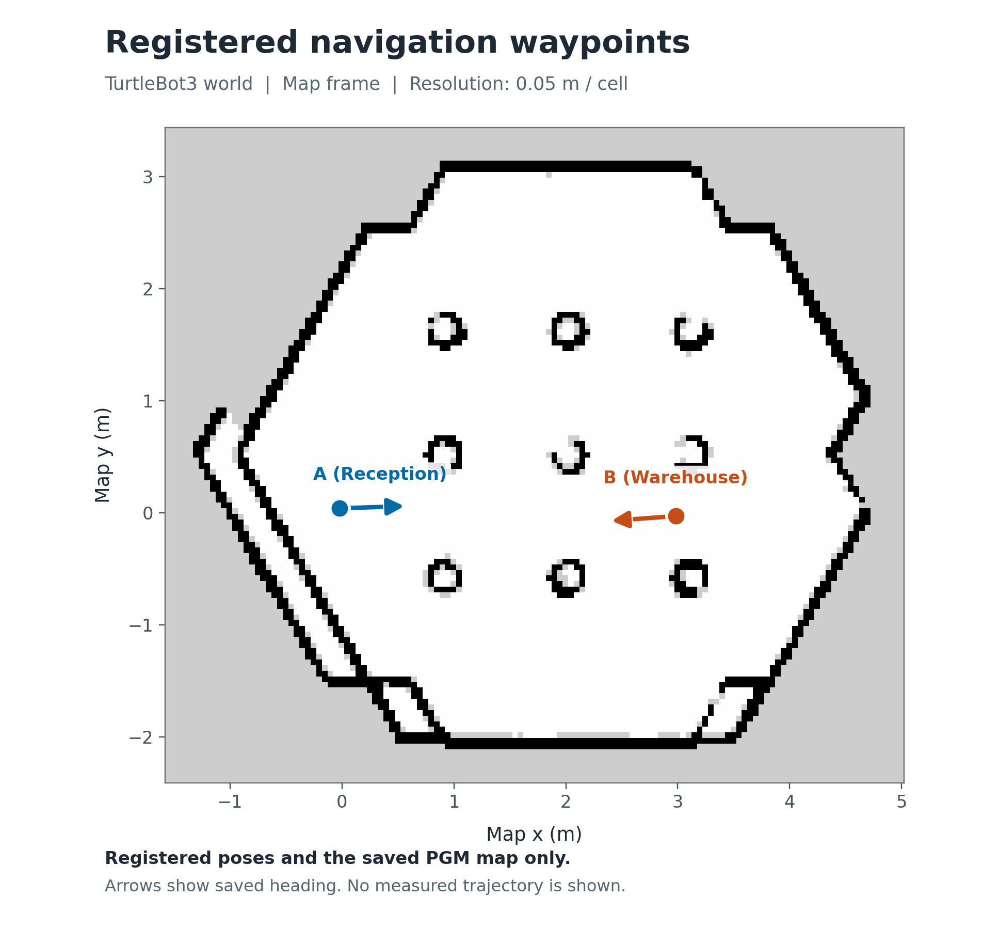

# 確認質問を備えた自然言語ロボットナビゲーション

自然言語で受付・倉庫への移動を指示し、Google Gemini API が訪問順を生成、ROS 2 Humble / Nav2 が Gazebo 内のロボットを移動させる。曖昧な指示や未登録地点を含む指示には確認質問を返し、経路全体が確定するまで移動を開始しない。

講義の Docker 環境と Happy Mini のシミュレーションを基盤に、自然言語から計画への変換、生成結果の検証、順次実行、JSONL による記録を追加した。AI は事前学習済みモデルの推論を利用し、追加学習は行っていない。

| ID | 地点名 | 保存姿勢 |
|---|---|---|
| `A` | 受付 | [poses/point_a.yaml](poses/point_a.yaml) |
| `B` | 倉庫 | [poses/point_b.yaml](poses/point_b.yaml) |

**モデルに渡すのは指示と地点名・ID の対応であり、座標・現在位置・カメラ画像は渡していない。** 座標は実行側が保存ファイルから読み込む。センサーに基づく自己位置推定、経路計画、速度制御は AMCL / Nav2 が担う。



図は保存地図と登録姿勢を示す。矢印は保存した向きであり、走行軌跡ではない。

## 実装上の工夫

- **自然言語から訪問順へ変換**: 「受付、倉庫、受付」を `["A", "B", "A"]` に変換し、同じ地点への再訪も扱う。
- **実行前の確認質問**: 「戻って」の戻り先や未登録の行き先を推測で埋めず、`clarify` と空の経路を返す。先頭の既知地点への部分的な移動も行わない。
- **プログラムによる検証**: 構造化出力を受け取った後も、JSON の形式、地点 ID、訪問数、`status` と経路の整合を検証する。応答の拒否・途中終了・検証エラーでは移動を開始しない。
- **区間ごとの実行と記録**: 各ゴールの成功を確認して次へ進む。入力、計画、API 使用量、区間別結果を一つの実行 ID で追跡できる。

## 確認した結果

利用者の講義コンテナで Gemini API と Gazebo を接続して実行したログを収録した。通常実行は以下の 4 ケースを各 2 回、合計 8 回。別に計画確認のみの実行が 1 回あり、記録は合計 9 回だ。

| 指示 | 通常実行回数 | 計画と結果 |
|---|---:|---|
| 受付に行ってから倉庫へ行って | 2 | `ready` / `["A", "B"]`。合計 4 ゴールが `SUCCEEDED` |
| 受付、倉庫、受付の順に回って | 2 | `ready` / `["A", "B", "A"]`。合計 6 ゴールが `SUCCEEDED` |
| 倉庫に行って戻って | 2 | `clarify` / `[]`。`goal_start` なし |
| 受付、検査室、倉庫の順に回って | 2 | `clarify` / `[]`。`goal_start` なし |

移動した 4 実行の計 10 ゴールはすべて `SUCCEEDED`。確認質問になった 4 実行では、ログ上、移動ゴールを開始していない。

- 全 9 回の API 応答時間は **1.070～3.213 秒、平均 1.943 秒**。
- 通常実行全体の所要時間は A → B が **36.495～38.592 秒**、A → B → A が **53.496～54.283 秒**。API・ROS の準備・走行・終了処理を含む。

集計は [公開ログ](evidence/gemini_nav_20261025.jsonl) と [集計結果](evidence/summary.json) に基づく。全体所要時間には `finish.elapsed_seconds` の単調時計による実時間を使い、UTC タイムスタンプの差と混同しない。各試行の初期姿勢の統一は確認しておらず、所要時間は性能比較用ではない。任意の指示に対する成功率や最終位置誤差は評価していない。

## 再現手順

### 1. 環境を準備する

詳しい Docker・Gazebo・Nav2 の起動方法は [docs/ENVIRONMENT.md](docs/ENVIRONMENT.md) を参照する。既存の `pai_ros2` がある場合は、そのコンテナと地図を再利用できる。

以降は、[http://localhost:6080](http://localhost:6080) の Ubuntu デスクトップで開いた Terminator から、**このリポジトリーのルート**で実行する。配置例は `/workspace/pai_gemini_v1` だ。

```bash
cd /workspace/pai_gemini_v1
```

API 通信は Python 標準ライブラリーの `urllib` を使用する。Google SDK や追加の `pip install` は不要だ。`--plan-only` では ROS / Gazebo / Nav2 の起動も不要である。

### 2. API キーを設定する

[Google AI Studio の API キーページ](https://aistudio.google.com/apikey) で、利用するプロジェクトのキーを用意する。**次の 1 行だけを実行する。**

```bash
read -r -s -p "Gemini API key: " GEMINI_API_KEY
```

入力待ちでキーを貼り付けて `Enter` を押す。入力は画面に表示されない。入力後、別途次を実行する。

```bash
printf '\n'
export GEMINI_API_KEY
export GEMINI_MODEL=gemini-3.5-flash-lite
```

キーはこのターミナルから起動したプログラムで使う。新しいターミナルでは再設定する。

既定の `gemini-3.5-flash-lite` は [料金表](https://ai.google.dev/gemini-api/docs/pricing) に無料枠があるが、対象プロジェクトの実効割当量・課金状態を確認する。課金済みプロジェクトがモデルの選択だけで自動的に無料利用へ切り替わるわけではなく、無料枠にも HTTP `429` になる制限がある。

### 3. 計画だけを確認する

```bash
/usr/bin/python3 -u nav_gemini.py --poses-dir ./poses --log-file ./logs/gemini_nav.jsonl \
  --plan-only '受付に行ってから倉庫へ行って'
```

`status: ready` と `route: ["A", "B"]` を確認する。結果の `message` は計画の説明または確認質問だ。構造化出力は応答の形式を制約するが、自然言語の解釈の正しさまで保証しない。

### 4. 移動する

[環境手順](docs/ENVIRONMENT.md) に従って Gazebo と Nav2 を起動し、RViz の `2D Pose Estimate` で必要な初期姿勢を指定する。レーザーと地図の整合を確認してから、同じターミナルで実行する。

```bash
source /opt/ros/humble/setup.bash
source /home/ubuntu/airobot_ws/install/setup.bash
export RMW_IMPLEMENTATION=rmw_cyclonedds_cpp
/usr/bin/python3 -u nav_gemini.py --poses-dir ./poses --log-file ./logs/gemini_nav.jsonl \
  '受付、倉庫、受付の順に回って'
```

本実行では API を再度呼ぶ。先ほどの計画を再生する機能ではない。現在地が A 付近なら、最初の A はほぼその場で到着判定され、その後 B → A と移動する。各地点の成功を待って次へ進む。

中断する場合は実行中のターミナルで `Ctrl+C` を押す。現在ゴールのキャンセルを要求し、残りの地点へ進まず終了する。複数の CLI を並行実行せず、走行中は RViz から別ゴールを送らない。

### 5. 確認質問を確かめる

次はどちらも **`--plan-only` を付けない通常実行**だ。`clarify` / `[]` で移動前に終了することを確認する。

```bash
/usr/bin/python3 -u nav_gemini.py --poses-dir ./poses --log-file ./logs/gemini_nav.jsonl \
  '倉庫に行って戻って'
```

```bash
/usr/bin/python3 -u nav_gemini.py --poses-dir ./poses --log-file ./logs/gemini_nav.jsonl \
  '受付、検査室、倉庫の順に回って'
```

1 回の起動で 1 指示を処理し、会話履歴は保持しない。確認後は「倉庫に行ってから受付へ戻って」のように、**不足する情報を含めて指示全文を入力し直す**。

## ログとテスト

```bash
tail -n 20 ./logs/gemini_nav.jsonl
/usr/bin/python3 -m unittest discover -s tests
```

オフラインテストは **24 件成功**。API キー未設定時の終了、計画の検証、API 応答の処理などを確認している。実 API と ROS の接続を使う検証とは分けて扱う。

公開した検証ログから集計結果を再生成できる。

```bash
/usr/bin/python3 tools/summarize_log.py evidence/gemini_nav_20261025.jsonl > evidence/summary.json
```

集計が期待するケースと整合する場合は終了コード `0`、不整合時は `1` となる。公開ログは `response_id` を除き、`run_id` を `trial_01`～`trial_09` に置換している。計画・使用量・時刻・経過時間は保持している。

## オプションと設計の範囲

| オプション | 変更していないアプリの既定値 |
|---|---|
| `--poses-dir` | `/workspace/poses` |
| `--log-file` | `/workspace/logs/gemini_nav.jsonl` |
| `--timeout` | 各区間 `180` 秒 |
| `--api-timeout` | 接続・読み取り `60` 秒 |
| `--model` | `GEMINI_MODEL`、未設定なら `gemini-3.5-flash-lite` |

この README のコマンドでは、配布した姿勢を使うため `--poses-dir ./poses` を、新しい実行ログを保存するため `--log-file ./logs/gemini_nav.jsonl` を明示している。

- 対応地点は A / B、1 指示は最長 8 訪問。順次移動のみを扱い、物体操作や条件分岐は行わない。
- 現在位置や画像を LLM に渡さないため、「ここへ戻る」「近い方へ行く」の目的地を自動決定しない。「今いる場所から倉庫へ行く」は目的地 B が明確なので扱える。
- `--timeout` は BasicNavigator 内部の応答待ちを完全には制限しない。`--api-timeout` も処理全体の厳密な制限時間ではない。
- API は `generateContent`、`responseFormat.text` の JSON Schema、`thinkingLevel: LOW`、`maxOutputTokens: 4096` を使う。モデルを変更する場合はこれらの対応を確認する。

API の `400` / `401` / `403` ではキー・権限・利用条件、`402` では Google Prepay の残高、`404` ではモデル ID、`429` ではプロジェクトの割当量を確認する。API の生エラー本文やキーはログに出さず、自動再試行もしない。詳細は [Google の API エラー説明](https://ai.google.dev/gemini-api/docs/generate-content/api-errors) を参照する。

## ファイルと提出資料

| ファイル | 役割 |
|---|---|
| [nav_gemini.py](nav_gemini.py) | API 呼び出し、計画の検証、CLI、ログ |
| [nav_executor.py](nav_executor.py) | 保存姿勢の読み込み、Nav2 の順次実行 |
| [maps/tb3_world.yaml](maps/tb3_world.yaml) / [maps/tb3_world.pgm](maps/tb3_world.pgm) | 保存地図 |
| [poses](poses) | A / B の登録姿勢 |
| [evidence](evidence) | 実行ログと再集計可能な検証結果 |
| [docs/ENVIRONMENT.md](docs/ENVIRONMENT.md) | Docker・ROS・Gazebo・Nav2 の再現手順 |
| [docs/VIDEO.md](docs/VIDEO.md) | 1～3 分動画の撮影手順 |
| [docs/report.pdf](docs/report.pdf) | 課題概要、工夫、結果をまとめたレポート |

コードは公開 GitHub リポジトリーで提出し、動画と PDF も課題の指定に従って提出する。成果物には氏名・所属・メールアドレスなどを入れない。OmniCampus のアカウント名は課題の指定範囲で使用できる。

## 使用した基盤・参考資料

- [講義 Docker イメージの配布元](https://github.com/AI-Robot-Book-Humble/docker-ros2-desktop-ai-robot-book-humble)
- [Happy Mini / TurtleBot3 の配布元](https://github.com/AI-Robot-Book-Humble/turtlebot3_happy_mini)
- [Google: Gemini 3.5 Flash-Lite](https://ai.google.dev/gemini-api/docs/models/gemini-3.5-flash-lite)
- [Google: 構造化出力](https://ai.google.dev/gemini-api/docs/generate-content/structured-output)
- [Google: API キー](https://ai.google.dev/gemini-api/docs/api-key) / [レート制限](https://ai.google.dev/gemini-api/docs/rate-limits)
